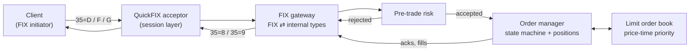
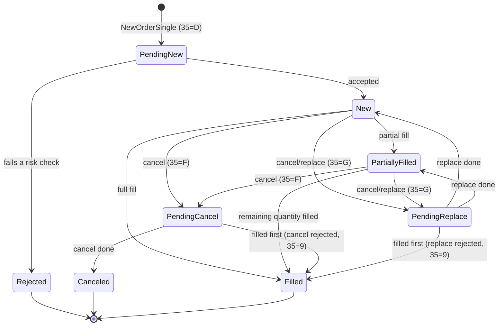

# MiniOEMS

A FIX 4.4 order gateway in C++20 with pre-trade risk checks, an explicit order-lifecycle state machine, and an in-process limit order book.

> **Status: work in progress.** This README describes the design. Anything marked *planned* is not implemented yet, and the results table shows only numbers that have actually been measured.

## What it does

MiniOEMS is the core of an order and execution management system (OEMS). Clients connect over FIX 4.4 and send orders. Each order is:

1. **Received and validated.** QuickFIX handles the FIX session layer: logon, heartbeats, sequence numbers and resends.
2. **Risk-checked** before it goes anywhere.
3. **Tracked** by a state machine that refuses illegal transitions.
4. **Matched** in a price-time-priority limit order book.
5. **Reported back** with an ExecutionReport for every change.

## Architecture



The gateway, risk engine, order manager and order book run on a single thread (QuickFIX's `SocketAcceptor`), so the core needs no locks and is deterministic: the same input always produces the same output.

## Order lifecycle



Any transition not in this table is rejected and leaves the order unchanged. For example, a fill on a canceled order is refused. In FIX 4.4 a successful replace is reported with `ExecType=5` (Replaced), while `OrdStatus` shows the order's current state.

## Pre-trade risk checks

These checks run in order, cheapest first, and stop at the first failure:

1. The account and symbol are known, and the symbol is open for trading.
2. Quantity is above zero and within the per-symbol maximum.
3. Price is positive and on the tick grid.
4. Price is within a band around the symbol's reference price, to catch "fat finger" errors.
5. Notional (price × quantity) is within the per-account maximum. It's computed in 128 bits, so a huge order can't overflow and slip under the limit.
6. The worst-case position in the symbol is within the account's limit. Worst case means current position, plus every open order on the same side, plus this order. Otherwise ten orders, each under the limit, could breach it together.
7. Gross exposure across all symbols is within the account's limit. This is worst-case positions valued at reference prices.

An order that doesn't increase the worst case is always allowed, even if the account is already over a limit (for example, after the limit was lowered during the day). That covers a sell while long, or a replace that shrinks an order. Cancels are never checked, because reducing risk must always be possible. A cancel/replace is re-checked against its new price and quantity.

Limits and exposures sit in flat arrays indexed by small integer IDs, so a check does no hashing, no memory allocation and no locking.

## FIX messages

| Message | `35=` | Direction |
|---|---|---|
| NewOrderSingle | `D` | in |
| OrderCancelRequest | `F` | in |
| OrderCancelReplaceRequest | `G` | in |
| ExecutionReport (new, partial fill, fill, canceled, replaced, rejected) | `8` | out |
| OrderCancelReject | `9` | out |

These edge cases are covered by tests (*planned*): duplicate `ClOrdID`, cancel before acknowledgement, cancels for unknown orders, out-of-sequence messages, and `PossDupFlag`/`PossResend` resends.

## Results

| Metric | Design target | Measured | How measured |
|---|---|---|---|
| Risk-check latency | ~1 µs per order | **7.4 ns** median (passes every check); 1.5 ns when rejected by the first check; 14.1 ns including exposure updates for an accepted, filled order | `bench/risk_benchmark` (Google Benchmark, 10 repetitions, median), over 4,096 varied orders across 500 symbols and 50 accounts. Intel Core Ultra 7 165U laptop, Windows 11, GCC 16.1, Release build. |
| End-to-end throughput (local FIX sessions) | 20,000 orders/s | not yet measured | |
| Test cases | 120 | not yet final (181 so far) | |

All numbers come with hardware, OS and method. A missed target stays in the table with an explanation.

The risk number is the check measured on its own, in a tight loop with warm caches. Inside a real order flow it competes with FIX parsing and the network for cache space, and the end-to-end breakdown will show its real share. The laptop numbers will be re-measured on a 2-core Linux VM.

## Tech stack

| Component | Choice |
|---|---|
| Language | C++20 |
| FIX engine | [QuickFIX](https://github.com/quickfix/quickfix), built from source at a pinned commit |
| Order book | Written from scratch for this project |
| Build | CMake |
| Tests | GoogleTest |
| Microbenchmarks | Google Benchmark |
| CI | GitHub Actions on Ubuntu (*planned*) |

## Why these choices

- **QuickFIX for the session layer.** Sequence numbers, gap detection, resends and heartbeats are easy to get subtly wrong. QuickFIX is a mature open-source engine, which leaves this project free to focus on order handling and risk.
- **Fixed-point prices.** Prices are stored as integers (for example, 10.25 becomes 102500). Floating-point rounding has no place in money calculations.
- **Explicit transition table.** Illegal order states can't occur by accident, and every transition is testable.
- **Single-threaded core.** No locks, deterministic behaviour, and easy replay of any scenario.
- **Testing against simple reference models.** The order book is checked against a flat-list book that's slow but obviously correct, over 200,000 random operations. The risk engine's incrementally updated exposure is checked against a full recount, over 100,000 random operations. The state machine gets 250,000 random events. Seeds are fixed, so every run is identical. To prove the tests can fail, deliberate bugs were planted in each component, and every one was caught by at least two tests.

## Building

You need Git, bash, CMake 3.25 or newer, Ninja, and a C++20 compiler.

- **Linux:** `sudo apt install build-essential cmake ninja-build git`
- **Windows:** MSYS2 with the MinGW-w64 toolchain (`pacman -S mingw-w64-x86_64-gcc mingw-w64-x86_64-ninja`). Run the script from Git Bash or an MSYS2 shell.

```bash
bash scripts/build.sh            # Release build; Debug: bash scripts/build.sh Debug
```

This single command does three things:

1. Builds QuickFIX from its pinned commit, the first time only (a few minutes).
2. Builds MiniOEMS.
3. Runs the tests.

Build output goes to `build/`. On Windows, if the repository sits inside a OneDrive folder, output goes to `%LOCALAPPDATA%\mini-oems\build` instead, because OneDrive locks the build folders it syncs. Set `MINI_OEMS_BUILD_ROOT` to choose another location.

QuickFIX doesn't officially support MinGW. `scripts/build_quickfix.sh` applies [`third_party/quickfix/mingw.patch`](third_party/quickfix/), which makes MinGW use QuickFIX's existing Windows (Winsock) code paths. The patch has no effect on Linux. On Windows, QuickFIX's own acceptance test suite passes in full with the patch applied.

## Limitations

- Limit orders only (Day and IOC time-in-force).
- Reference prices come from a config file, not a live market-data feed.
- Order state is held in memory. QuickFIX persists session messages, but order state isn't recovered after a restart.
- A single venue: an in-process order book with no smart order routing.

## License

This project's code is released under the [MIT License](LICENSE).

QuickFIX is distributed under the QuickFIX Software License, Version 1.0, a BSD-style licence. See the QuickFIX repository for its terms.
