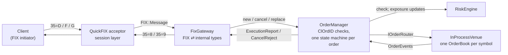
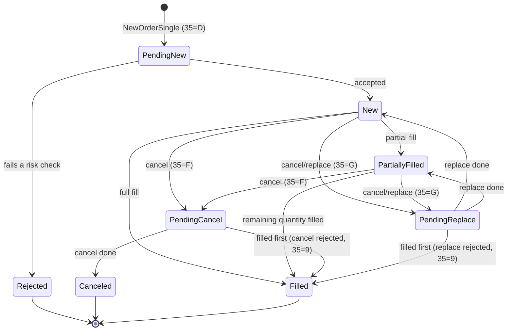

# MiniOEMS

A FIX 4.4 order gateway in C++20 with pre-trade risk checks, an explicit order-lifecycle state machine, and an in-process limit order book.

> **Status:** feature-complete, with 227 tests. Microbenchmarks are measured; end-to-end FIX throughput will be measured on a 2-core Linux VM.

## What it does

MiniOEMS is the core of an order and execution management system (OEMS). Clients connect over FIX 4.4 and send orders. Each order is:

1. **Received and validated.** QuickFIX handles the FIX session layer: logon, heartbeats, sequence numbers and resends.
2. **Risk-checked** before it goes anywhere.
3. **Tracked** by a state machine that refuses illegal transitions.
4. **Matched** in a price-time-priority limit order book.
5. **Reported back** with an ExecutionReport for every change.

## Architecture



- **`FixGateway`** is the only code that knows FIX.
- **`OrderManager`** owns the orders. It asks `RiskEngine` before anything goes out, sends requests through the `IOrderRouter` interface, and applies every event that comes back to that order's state machine.
- **`InProcessVenue`** puts orders on the order book, one book per symbol. A real exchange connection could replace it behind the same interface.

Everything runs on one thread (QuickFIX's `SocketAcceptor`), so the core needs no locks and is deterministic: the same input always produces the same output.

### Project layout

| Path | What's there |
|---|---|
| `include/oems/`, `src/` | `types` (fixed-point prices), `order` (state machine), `order_book`, `in_process_venue`, `risk`, `order_manager`, `config`, plus `fix_gateway` and `fix_settings` (the FIX edge) and `main.cpp` (the `mini_oems` executable) |
| `tests/` | GoogleTest suites, including the end-to-end FIX tests |
| `bench/` | `risk_benchmark`, `pipeline_benchmark`, `oems_load_client`, and `results/` |
| `config/` | gateway, benchmark and load-client settings; instrument and account limits |
| `scripts/` | `build.sh` (build and test), `bench.sh` (all benchmarks), `build_quickfix.sh` |
| `third_party/quickfix/` | the MinGW patch for QuickFIX and its notes |

## Order lifecycle



Any transition not in this table is rejected and leaves the order unchanged. For example, a fill on a canceled order is refused. In FIX 4.4 a successful replace is reported with `ExecType=5` (Replaced), while `OrdStatus` shows the order's current state.

## Pre-trade risk checks

These checks run in order, cheapest first, and stop at the first failure:

1. The account and symbol are known, and the symbol is open for trading.
2. Quantity is above zero and within the per-symbol maximum.
3. Price is positive and on the tick grid.
4. Price is within a band around the symbol's reference price, to catch "fat finger" errors.
5. Notional (price × quantity) is within the per-account maximum. It's computed in 128 bits, so a huge order can't overflow and slip under the limit.
6. The worst-case position in the symbol is within the account's limit. Worst case means current position, plus every open order on the same side, plus this order. Otherwise ten orders, each under the limit, could breach it together.
7. Gross exposure across all symbols is within the account's limit. This is worst-case positions valued at reference prices.

An order that doesn't increase the worst case is always allowed, even if the account is already over a limit (for example, after the limit was lowered during the day). That covers a sell while long, or a replace that shrinks an order. Cancels are never checked, because reducing risk must always be possible. A cancel/replace is re-checked against its new price and quantity.

Limits and exposures sit in flat arrays indexed by small integer IDs, so a check does no hashing, no memory allocation and no locking.

## FIX messages

| Message | `35=` | Direction |
|---|---|---|
| NewOrderSingle | `D` | in |
| OrderCancelRequest | `F` | in |
| OrderCancelReplaceRequest | `G` | in |
| ExecutionReport (new, partial fill, fill, canceled, replaced, rejected) | `8` | out |
| OrderCancelReject | `9` | out |

Any other message type gets a BusinessMessageReject (`35=j`). Prices and quantities are read from the raw FIX text and parsed exactly, so no value ever passes through a `double`. A price with more than 4 decimal places is rejected, not rounded.

### Duplicates, resends and gaps

| Situation | What happens |
|---|---|
| A `ClOrdID` is reused | Rejected: `OrdRejReason=6` for a new order, `CxlRejReason=6` for a cancel/replace. No second order is created. ClOrdIDs are unique per FIX session. |
| A `NewOrderSingle` arrives again with `PossResend=Y` or `PossDupFlag=Y`, and we already have it | A status report (`ExecType=I`) with the order's current state. Nothing changes. |
| The same flag, but we've never seen that `ClOrdID` | Processed as a new order, because the original was lost. |
| A copy with `PossDupFlag=Y` and a sequence number we've already processed | Dropped by QuickFIX's session layer; the application never sees it. |
| A message arrives out of sequence (a gap) | QuickFIX holds it, asks the client to resend the missing range (`35=2`), processes the resent messages in order, then the held one, exactly once. |
| A cancel or replace arrives before the client saw the order's acknowledgement | Requests are handled in arrival order, so the order is already accepted and the cancel finds it. |
| A cancel names an unknown order, or one that's already done | `OrderCancelReject` with `CxlRejReason=1` (unknown) or `0` (too late). |

All of these are tested over a real localhost FIX connection, with QuickFIX on both ends (`tests/fix_gateway_test.cpp`).

## Results

Microbenchmarks were measured on an Intel Core Ultra 7 165U laptop running Windows 11, MinGW-w64 GCC 16.1, Release build. Reproduce everything with `bash scripts/bench.sh`.

| Metric | Measured | How measured |
|---|---|---|
| Risk-check latency | **11.6 ns** median for an order that passes every check (7.4 ns in another run on the same laptop); 2.2 ns when rejected by the first check; 21.7 ns including exposure updates for an accepted, filled order | `bench/risk_benchmark`: Google Benchmark, 10 repetitions, median, over 4,096 varied orders across 500 symbols and 50 accounts |
| Gateway work per order | **≈ 12 µs**, stage by stage below | `bench/pipeline_benchmark`: Google Benchmark, 5 repetitions, median |
| End-to-end throughput and latency over FIX | To be measured on a 2-core Linux VM | `oems_load_client` against `mini_oems` over localhost |
| Test cases | **227**, all passing in Release and Debug, including duplicate ClOrdIDs, a PossDupFlag resend and an out-of-sequence gap over real FIX sessions | `ctest`; see [Tests](#tests) |

The risk number is the check measured on its own, in a tight loop with warm caches.

### Where the time goes

The gateway's own work for one order, measured stage by stage (`bench/pipeline_benchmark`, median):

| Stage | Time |
|---|---|
| QuickFIX parses the message | 1.5 µs |
| QuickFIX validates it against the FIX 4.4 dictionary | 1.3 µs |
| The gateway translates it into an internal order | 0.2 µs |
| The order manager: duplicate check, risk, matching, state machine, exposure | 1.8 µs |
| Build and serialise the execution reports: 2 per order in this flow, 3.6 µs each | 7.1 µs |
| **Total** | **≈ 12 µs** |

QuickFIX is most of this work: parsing, validation and building replies come to about 10 of the 12 µs. This project's own code (translation, order manager, risk) is about 2 µs per order.

Beyond the message work, there's I/O. A CPU profile on Windows found that, under load, most of the gateway's CPU went to system calls in QuickFIX's Windows event loop, not to processing messages. That loop makes about five system calls for every message it sends:
1. `select()`, to check the socket is writable;
2. `send()`, for the message itself;
3. a write to an internal wake-up socket;
4. a `recv()` and another `select()` in the event loop, to consume that wake-up.

What would make it faster, roughly in order of effort:
1. **Run on Linux,** where system calls are much cheaper.
2. **Fewer system calls.** Send all of an event-loop pass's replies in one call, and skip the wake-up socket when the event loop's own thread is the one sending.
3. **Get disk writes off the critical path.** Log asynchronously, and write the message store in batches.
4. **A leaner FIX path for the hot messages.** Parse NewOrderSingle and write ExecutionReport straight from and into a buffer, with no field map.
5. **Kernel-bypass networking**, which is what high-frequency firms use.

## Tests

| Suite | Tests | What it covers |
|---|---|---|
| Order lifecycle | 80 + 13 | Every state × event pair against an independently written spec; scenarios such as a fill beating a cancel, replacing down to the filled quantity, and average price; 250,000 random events checking invariants |
| Prices and quantities | 33 | Exact FIX decimal parsing, including what must be refused, plus formatting and a 100,000-value round trip |
| Order book | 19 + 1 | Priority rules, sweeping levels, IOC, cancel, replace priority; 200,000 random operations against a reference book |
| Venue | 10 + 1 | Event sequences, plus 30,000 random operations with every event applied to the state machine |
| Risk | 21 + 1 | Each limit at and just past its boundary, check order and overflow; 100,000 random operations against a full exposure recount |
| Order manager | 25 + 1 | Every reject path, resends, ClOrdID scoping; 20,000 random requests: every request answered, exposure always equal to a recount |
| FIX gateway (end to end) | 16 | Over localhost with a QuickFIX client: values on the wire, trades, rejects, duplicates, PossResend, cancel/replace, cancel before ack, BusinessMessageReject, a PossDupFlag resend, gap recovery |
| Config, QuickFIX smoke | 4 + 2 | Limit files, including errors with line numbers; QuickFIX links and parses FIX 4.4 |

The random tests use fixed seeds, so every run sees the same flow. To prove the suite can fail, deliberate bugs were planted in the state machine, order book and risk engine. Every one was caught by at least two tests. The order manager's random test found a real bug while it was being written: a `PossResend` order reusing a cancel's ClOrdID got the status of the order that cancel had targeted, instead of being rejected as a duplicate.

## Tech stack

| Component | Choice |
|---|---|
| Language | C++20 |
| FIX engine | [QuickFIX](https://github.com/quickfix/quickfix), built from source at a pinned commit |
| Order book | Written from scratch for this project |
| Build | CMake |
| Tests | GoogleTest |
| Microbenchmarks | Google Benchmark |
| CI | GitHub Actions on Ubuntu, Release and Debug builds (configured; runs once the repository is on GitHub) |

## Why these choices

- **QuickFIX for the session layer.** Sequence numbers, gap detection, resends and heartbeats are easy to get subtly wrong. QuickFIX is a mature open-source engine, which leaves this project free to focus on order handling and risk.
- **Fixed-point prices.** Prices are stored as integers (for example, 10.25 becomes 102500). Floating-point rounding has no place in money calculations.
- **Explicit transition table.** Illegal order states can't occur by accident, and every transition is testable.
- **Single-threaded core.** No locks, deterministic behaviour, and easy replay of any scenario.
- **FIX only at the edge.** The order manager, risk engine, order book and state machine don't know FIX exists. `FixGateway` is the only code that touches QuickFIX, so the core is tested without sockets, and swapping the protocol wouldn't touch it.
- **Every new ClOrdID gets an order, even one about to be rejected.** The client always gets an OrderID back, and a rejected ClOrdID can't be quietly reused.
- **Testing against simple reference models.** A slow but obviously correct model catches bugs that hand-written cases miss. The order book is checked against a flat-list book, and the risk engine's incremental exposure against a full recount.
- **A plain `std::map` of price levels, each a FIFO list, plus a hash index by order ID.** Every operation is O(log levels) or better, and cancels never search a level. A flat, preallocated layout would be faster, but the benchmarks show the book isn't the bottleneck: it's part of the order manager's 1.8 µs.
- **Measure before optimising.** The stage-by-stage benchmark and the CPU split show where the time actually goes. Here that's QuickFIX's system calls, not anything this project would have guessed to optimise.

## Building

You need Git, bash, CMake 3.25 or newer, Ninja, and a C++20 compiler.

- **Linux:** `sudo apt install build-essential cmake ninja-build git`
- **Windows:** MSYS2 with the MinGW-w64 toolchain (`pacman -S mingw-w64-x86_64-gcc mingw-w64-x86_64-ninja`). Run the script from Git Bash or an MSYS2 shell.

```bash
bash scripts/build.sh            # Release build; Debug: bash scripts/build.sh Debug
```

This single command does three things:

1. Builds QuickFIX from its pinned commit, the first time only (a few minutes).
2. Builds MiniOEMS.
3. Runs the tests.

Build output goes to `build/`. On Windows, if the repository sits inside a OneDrive folder, output goes to `%LOCALAPPDATA%\mini-oems\build` instead, because OneDrive locks the build folders it syncs. Set `MINI_OEMS_BUILD_ROOT` to choose another location.

QuickFIX doesn't officially support MinGW. `scripts/build_quickfix.sh` applies [`third_party/quickfix/mingw.patch`](third_party/quickfix/), which makes MinGW use QuickFIX's existing Windows (Winsock) code paths. The patch has no effect on Linux. On Windows, QuickFIX's own acceptance test suite passes in full with the patch applied.

## Running the gateway

```bash
mini_oems config/acceptor.cfg config/instruments.csv config/accounts.csv
```

The executable is in the build output folder.
- **`config/acceptor.cfg`** is a QuickFIX settings file. It listens on port 9878 for FIX 4.4 sessions `CLIENT1` and `CLIENT2`.
- **`config/instruments.csv`** sets each symbol's tick size, reference price, price band, maximum order size and whether it's tradable.
- **`config/accounts.csv`** sets each account's maximum order notional, maximum position per symbol and maximum gross exposure.

A malformed line in either CSV stops startup with the line number. A typo is never silently read as zero.

`config/acceptor.cfg` stores and logs every message on disk, the way production would. `config/bench_acceptor.cfg` keeps the session store in memory and doesn't log.

## Benchmarks

```bash
bash scripts/bench.sh    # after scripts/build.sh; prints everything, takes about 5 minutes
```

The script runs three things:
1. The risk check on its own.
2. Each stage of handling an order inside the gateway.
3. End-to-end throughput and latency: it starts `mini_oems`, drives it with `oems_load_client`, and does this with both gateway configs.

You can also run the load client by hand against a running gateway:

```bash
oems_load_client config/load_client.cfg config/instruments.csv ACC1 <orders> <max in flight>
```

## Limitations

- Limit orders only (Day and IOC time-in-force).
- Reference prices come from a config file, not a live market-data feed.
- Order state is held in memory. QuickFIX persists session messages, but order state isn't recovered after a restart.
- A single venue: an in-process order book with no smart order routing.
- No self-trade prevention: two orders from the same account can trade with each other.
- No pending-state reports. Cancels and replaces complete within the request, so clients get the final Canceled/Replaced report, never PendingCancel or PendingReplace.
- The sample session config resets sequence numbers on every logon (`ResetOnLogon=Y`), which keeps demos simple. A production setup keeps them for the whole trading day.

## Next steps

- Measure on a 2-core Linux VM and run CI on GitHub.
- **A kill switch:** one command that cancels every open order for an account and blocks new ones.
- **Throughput:** batch outgoing messages per event-loop pass, and take disk logging off the gateway thread.
- **Recovery:** journal order state so a restart can rebuild open orders and positions.
- Self-trade prevention, and reference prices from live market data.
- **More throughput:** shard symbols across threads, one order manager and book per shard.

## License

This project's code is released under the [MIT License](LICENSE).

QuickFIX is distributed under the QuickFIX Software License, Version 1.0, a BSD-style licence. See the QuickFIX repository for its terms.
