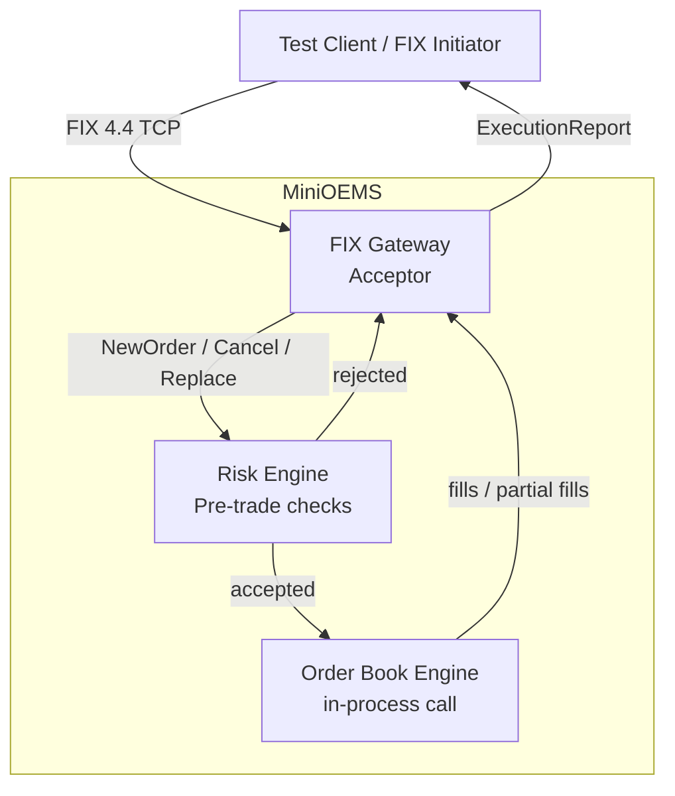

# MiniOEMS — FIX 4.4 Order Gateway with Pre-Trade Risk (C++20)

> **Resume target:** Polymer Capital

## Problem

Build the core of an order and execution management system:
a FIX 4.4 gateway that validates incoming orders, enforces pre-trade risk limits,
manages each order's full lifecycle, and routes accepted orders to an in-process
limit order book engine.

---

## Architecture



### Order Lifecycle State Machine

```
             ┌──────────┐
             │ PendingNew│
             └────┬─────┘
                  │ ACK
                  ▼
            ┌─────────┐
            │   New   │◄──────────────────────────┐
            └──┬──┬───┘                           │
         Fill  │  │ Cancel / Replace               │ Partial fill → back to New
               │  ▼                                │
               │ ┌──────────┐    ┌─────────────────┴──┐
               │ │ Canceled │    │  PartiallyFilled    │
               │ └──────────┘    └────────────────────┘
               ▼
          ┌────────┐    ┌──────────┐
          │ Filled │    │ Rejected │
          └────────┘    └──────────┘
```

Invalid transitions (e.g. cancel after fill) are rejected by the state machine —
not silently ignored.

---

## Tech Stack

| Component | Technology | Why this choice |
|---|---|---|
| Core language | C++20 | Zero-overhead abstractions, concepts for type-safe message dispatch |
| FIX protocol | QuickFIX (built from source on MinGW-w64) | Industry-standard open-source FIX engine; OSI-licensed (LGPL) |
| Order book | Custom limit order book engine (price-time priority) | Re-uses existing tested engine; in-process call avoids serialisation overhead |
| Build | CMake + MinGW-w64 (Windows) / GCC (Linux/Codespaces) | Reproducible single-command build on both platforms |
| Tests | GoogleTest (120 cases) | Standard C++ unit test framework |
| CI | GitHub Actions (ubuntu-latest) | Free tier, runs on every push |

---

## Pre-Trade Risk Checks

Checked in order, short-circuit on first failure:

1. **Max order quantity** — configurable per symbol
2. **Max notional** — `price × qty` vs per-account limit
3. **Per-account position limit** — gross exposure ceiling
4. **Per-symbol position limit** — concentration ceiling
5. **Price band** — order price within ± N% of reference price

All checks are branch-light and allocation-free on the hot path.

---

## FIX Messages Handled

| Message | Tag 35 | Direction |
|---|---|---|
| NewOrderSingle | D | Inbound |
| OrderCancelRequest | F | Inbound |
| OrderCancelReplaceRequest | G | Inbound |
| ExecutionReport (new / partial / fill / canceled / replaced / rejected) | 8 | Outbound |

Edge cases tested: duplicate `ClOrdID`, cancel before acknowledgement,
out-of-order messages, `PossDupFlag` resends.

---

## Results

| Metric | Resume target | Actual (measured) |
|---|---|---|
| Test coverage | 120 GoogleTest cases | _(fill in after benchmarks)_ |
| Risk-check latency | ~1 µs / order | _(fill in after benchmarks)_ |
| Throughput | 20 k orders/sec over local FIX sessions | _(fill in after benchmarks)_ |

> **Honest note:** QuickFIX message parsing is the dominant throughput cost.
> The results table will be updated with real measured numbers.
> Resume bullets will be revised to match.

---

## How to Build

### Prerequisites

- CMake ≥ 3.12
- GCC ≥ 11 (Linux / GitHub Codespaces) **or** MinGW-w64 via MSYS2 (Windows)
- QuickFIX built from source (see `scripts/build_quickfix.sh`)
- GoogleTest (fetched by CMake)
- OpenSSL (optional; required only for SSL sessions)

### Build steps

```bash
# 1. Build QuickFIX (first time only)
bash scripts/build_quickfix.sh

# 2. Build MiniOEMS
cmake -B build -DCMAKE_BUILD_TYPE=Release
cmake --build build -j4

# 3. Run tests
ctest --test-dir build --output-on-failure
```

---

## Running the Demo

```bash
# Terminal 1 — start the gateway
./build/mini_oems --config config/acceptor.cfg

# Terminal 2 — send test orders
./build/test_client --config config/initiator.cfg
```

---

## Limitations & Next Steps

- **No persistence** — orders are in-memory only; a crash loses state.
- **Single-threaded matching** — one match thread per session; add sharding for multi-symbol scale.
- **No market data** — price-band check uses a static reference price; a real system feeds it from a market-data stream.
- **QuickFIX parsing is the bottleneck** — see benchmark results for the breakdown.

Next steps: persistent order store (SQLite or flat-file journal), dynamic reference prices, FIX session management improvements.

---

## License

MIT — see [LICENSE](LICENSE).
