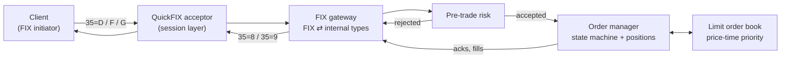
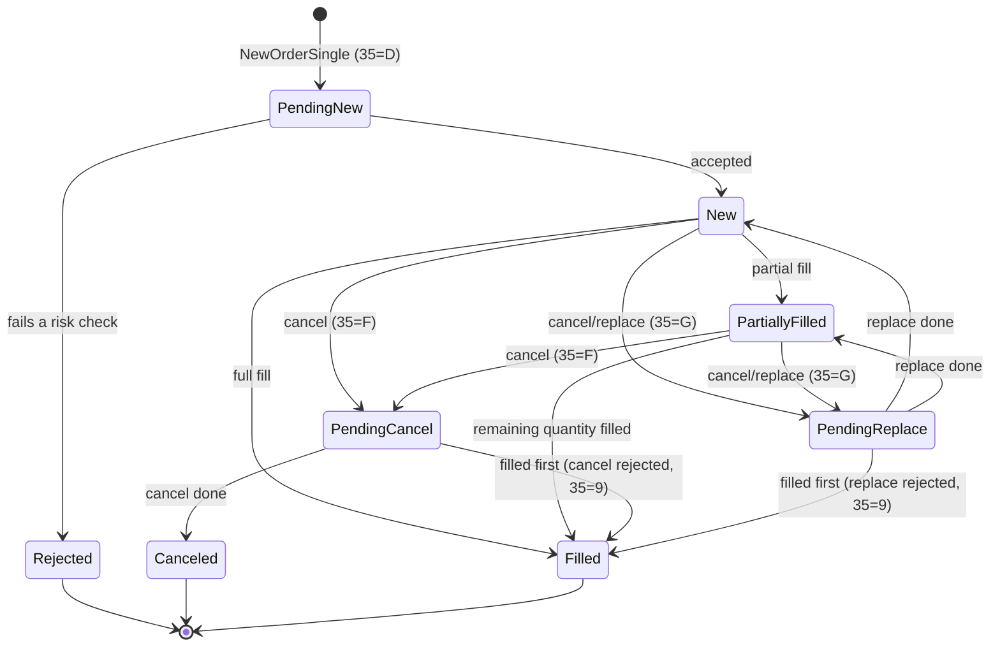

# MiniOEMS

A FIX 4.4 order gateway in C++20 with pre-trade risk checks, an explicit order-lifecycle state machine, and an in-process limit order book.

> **Status: work in progress.** This README describes the design. Anything marked *planned* is not implemented yet, and the results table shows only numbers that have actually been measured.

## What it does

MiniOEMS is the core of an order and execution management system (OEMS). Clients connect over FIX 4.4 and send orders. Each order is:

1. **Received and validated.** QuickFIX handles the FIX session layer: logon, heartbeats, sequence numbers and resends.
2. **Risk-checked** before it goes anywhere.
3. **Tracked** by a state machine that refuses illegal transitions.
4. **Matched** in a price-time-priority limit order book.
5. **Reported back** with an ExecutionReport for every change.

## Architecture

The gateway, risk engine, order manager and order book run on a single thread (QuickFIX's `SocketAcceptor`), so the core needs no locks and is deterministic: the same input always produces the same output.

## Order lifecycle

Any transition not in this table is rejected and leaves the order unchanged. For example, a fill on a canceled order is refused. In FIX 4.4 a successful replace is reported with `ExecType=5` (Replaced), while `OrdStatus` shows the order's current state.

## Pre-trade risk checks

These checks run in order, cheapest first, and stop at the first failure:

1. The symbol is known and allowed to trade.
2. Quantity is above zero and within the per-symbol maximum.
3. Price is positive and on the tick grid.
4. Price is within a band around a reference price, to catch "fat finger" errors.
5. Notional (price × quantity) is within the per-account maximum, using overflow-safe arithmetic.
6. The position limit holds for each account and symbol, and for each account overall. The check uses worst-case exposure: current position plus open orders plus the new order.

Cancels are never blocked by risk checks, because reducing risk must always be possible. A cancel/replace is re-checked against its new price and quantity.

## FIX messages

| Message | `35=` | Direction |
|---|---|---|
| NewOrderSingle | `D` | in |
| OrderCancelRequest | `F` | in |
| OrderCancelReplaceRequest | `G` | in |
| ExecutionReport (new, partial fill, fill, canceled, replaced, rejected) | `8` | out |
| OrderCancelReject | `9` | out |

These edge cases are covered by tests (*planned*): duplicate `ClOrdID`, cancel before acknowledgement, cancels for unknown orders, out-of-sequence messages, and `PossDupFlag`/`PossResend` resends.

## Results

| Metric | Design target | Measured | How measured |
|---|---|---|---|
| Risk-check latency | ~1 µs per order | not yet measured | |
| End-to-end throughput (local FIX sessions) | 20,000 orders/s | not yet measured | |
| Test cases | 120 | not yet measured | |

Numbers will be reported with hardware, OS and method. A missed target stays in the table with an explanation.

## Tech stack

| Component | Choice |
|---|---|
| Language | C++20 |
| FIX engine | [QuickFIX](https://github.com/quickfix/quickfix), built from source at a pinned commit |
| Order book | Written from scratch for this project |
| Build | CMake |
| Tests | GoogleTest |
| Microbenchmarks | Google Benchmark (*planned*) |
| CI | GitHub Actions on Ubuntu (*planned*) |

## Why these choices

- **QuickFIX for the session layer.** Sequence numbers, gap detection, resends and heartbeats are easy to get subtly wrong. QuickFIX is a mature open-source engine, which leaves this project free to focus on order handling and risk.
- **Fixed-point prices.** Prices are stored as integers (for example, 10.25 becomes 102500). Floating-point rounding has no place in money calculations.
- **Explicit transition table.** Illegal order states can't occur by accident, and every transition is testable.
- **Single-threaded core.** No locks, deterministic behaviour, and easy replay of any scenario.

## Building

*Planned.* Build scripts and instructions will arrive with the first code milestone. The targets are Windows (MSYS2 MinGW-w64 GCC) and Linux (GCC).

QuickFIX doesn't officially support MinGW. This project builds it from a pinned commit with a patch that makes MinGW use QuickFIX's existing Windows (Winsock) code paths.

## Limitations

- Limit orders only (Day and IOC time-in-force).
- Reference prices come from a config file, not a live market-data feed.
- Order state is held in memory. QuickFIX persists session messages, but order state isn't recovered after a restart.
- A single venue: an in-process order book with no smart order routing.

## License

This project's code is released under the [MIT License](LICENSE).

QuickFIX is distributed under the QuickFIX Software License, Version 1.0, a BSD-style licence. See the QuickFIX repository for its terms.
